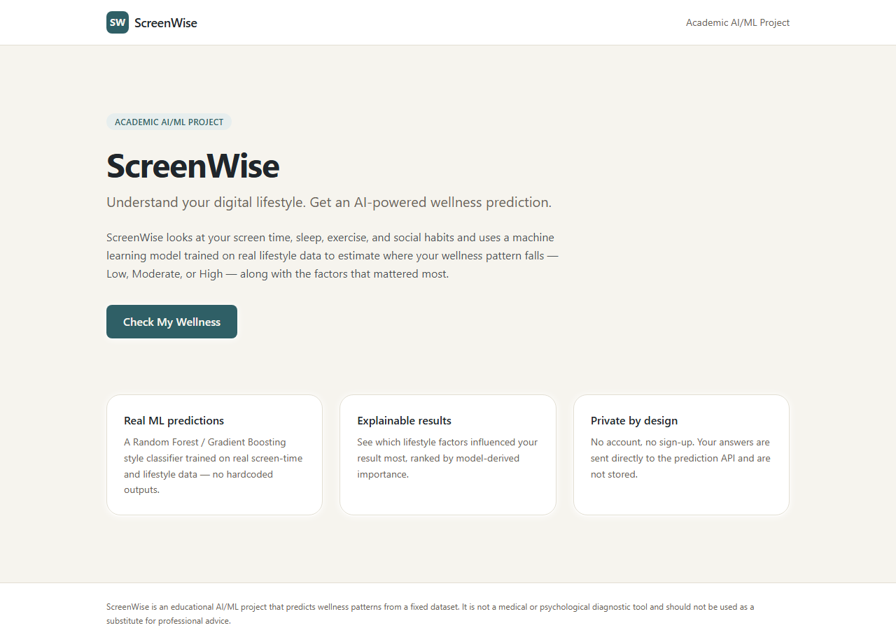
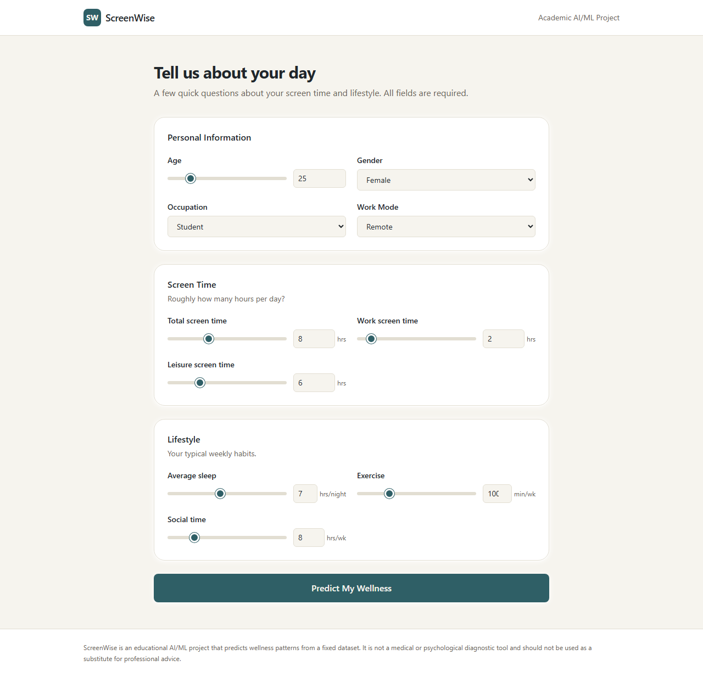
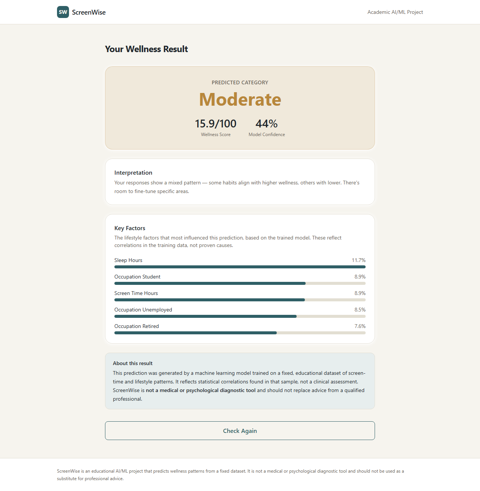

# ScreenWise

### AI-Based Mental Wellness Prediction Using Screen-Time and Lifestyle Patterns

ScreenWise is an end-to-end academic AI/ML web application. A user enters their age,
occupation, screen-time habits, sleep, exercise, and social time, and receives a
machine-learning-based prediction of their wellness pattern (Low / Moderate / High), a
0-100 wellness score, a model confidence, and the lifestyle factors that most influenced
the result.

> **Disclaimer:** ScreenWise is an educational AI/ML project that predicts wellness
> patterns from a fixed dataset. It is **not** a medical or psychological diagnostic tool
> and should not be used as a substitute for professional advice.

---

## 1. Problem Statement

Excessive or imbalanced screen time is commonly linked to lifestyle and wellness outcomes.
This project builds a supervised classifier that predicts a wellness category from a
person's screen-time and lifestyle inputs, and serves that model behind a real API and a
web UI — turning a static dataset into an interactive, explainable prediction tool.

## 2. Features

- Full ML pipeline: cleaning, target construction, feature engineering, model comparison,
  hyperparameter tuning, evaluation, and serialization.
- FastAPI backend serving real-time predictions from the actual trained model (no
  hardcoded outputs).
- React + Vite + Tailwind frontend with a 3-step form, loading states, and a result
  dashboard with feature-importance bars.
- Model explainability (top contributing factors per prediction).
- Automated tests for the ML pipeline, the API, and the frontend.
- No login, no Docker — runs natively with `pip install` / `npm install`.

## 3. Dataset Description

Source file: `data/ScreenTime vs MentalWellness.csv` (also present at the project root).

| Property | Value |
|---|---|
| Rows | 400 |
| Columns | 15 real columns (a trailing empty `Unnamed: 15` artifact column from the source CSV is dropped on load) |
| Missing values | 0 |
| Duplicate rows | 0 |

**Columns:**

| Column | Type | Description |
|---|---|---|
| `user_id` | string | Row identifier (dropped — not predictive) |
| `age` | int | Age in years (16–60 in the raw data) |
| `gender` | categorical | Female / Male / Non-binary/Other |
| `occupation` | categorical | Employed / Student / Self-employed / Retired / Unemployed |
| `work_mode` | categorical | Remote / In-person / Hybrid |
| `screen_time_hours` | float | Total daily screen time (hours) |
| `work_screen_hours` | float | Work-related screen time (hours/day) |
| `leisure_screen_hours` | float | Leisure screen time (hours/day) |
| `sleep_hours` | float | Average nightly sleep (hours) |
| `sleep_quality_1_5` | int (1–5) | Self-rated sleep quality — **excluded from features, see below** |
| `stress_level_0_10` | float (0–10) | Self-rated stress level — **excluded from features, see below** |
| `productivity_0_100` | float (0–100) | Self-rated productivity — **excluded from features, see below** |
| `exercise_minutes_per_week` | int | Weekly exercise minutes |
| `social_hours_per_week` | float | Weekly social time (hours) |
| `mental_wellness_index_0_100` | float (0–100) | Pre-computed wellness index — used as the prediction target |

## 4. Target Construction Methodology

The dataset already ships a `mental_wellness_index_0_100` column. EDA
(`notebooks/EDA.ipynb`, section 7) tests whether it matches the brief's suggested formula —
`normalized_productivity + normalized_sleep_quality + inverse_normalized_stress`, rescaled
to 0–100 — and finds a **0.96 correlation** between the two. This confirms the index was
already built from those three indicators, so `ml/preprocess.py` reuses the existing column
directly as the wellness score rather than re-deriving an approximation.

The raw index is then bucketed into three classes:

- **Fixed thresholds (0–33 / 34–66 / 67–100) were rejected.** The index is right-skewed
  (mean ≈ 20, 75th percentile ≈ 31), so a fixed split would put over 70% of records in
  "Low" and leave "High" almost empty.
- Instead, **tercile (33rd / 66th percentile) quantile thresholds** are computed on the
  cleaned dataset, giving a roughly balanced 3-class split: Low 134 / Moderate 133 / High 133.

### Data leakage prevention

`productivity_0_100`, `sleep_quality_1_5`, and `stress_level_0_10` were used to build the
target, so they are **excluded from the model's input features**. The model instead
predicts wellness from variables that don't encode the target directly: age, gender,
occupation, work mode, screen-time breakdown, sleep hours, exercise, and social time.

## 5. Feature Engineering

One derived feature is added, from non-leakage columns only:

- `leisure_screen_ratio` = `leisure_screen_hours / screen_time_hours` (share of total screen
  time that is leisure, clipped to `[0, 1]`).

## 6. Models Compared

Trained with an 80/20 stratified train/test split (`random_state=42`) and evaluated with
5-fold stratified cross-validation on the training set:

| Model | CV accuracy (mean ± std) |
|---|---|
| Logistic Regression | 0.647 ± 0.047 |
| Decision Tree | 0.547 ± 0.080 |
| Random Forest (tuned via GridSearchCV) | 0.631 |
| Gradient Boosting (tuned via GridSearchCV) | 0.625 |

Random Forest and Gradient Boosting were tuned with `GridSearchCV` over `n_estimators`,
`max_depth`, `min_samples_split`/`min_samples_leaf` (RF) and `learning_rate` (GB); best
params are recorded in `artifacts/metrics.json`.

## 7. Final Model Selection

**Selected: Logistic Regression**, chosen automatically by highest cross-validated training
accuracy among all candidates (untuned baselines + tuned RF/GB). On a small, noisy 400-row
dataset the simpler linear model generalized at least as well as the tree ensembles, and
its cross-validation standard deviation was the lowest of the four models. Because
Logistic Regression has no native `feature_importances_`, `ml/train.py` falls back to
mean absolute standardized coefficients (normalized to sum to 1) for the explainability step.

**Test-set metrics (one-time final evaluation, never used for model selection):**

| Metric | Value |
|---|---|
| Accuracy | 0.600 |
| Precision (weighted) | 0.594 |
| Recall (weighted) | 0.600 |
| F1 (weighted) | 0.596 |

Full confusion matrix and per-class report: `artifacts/metrics.json`.

**Top contributing factors** (from the trained model, see `artifacts/feature_info.json`):
`sleep_hours`, `occupation_Student`, `screen_time_hours`, `occupation_Unemployed`,
`occupation_Retired`, `work_screen_hours`, `gender_Non-binary/Other`, `gender_Female`.
These reflect **correlations found in a 400-row sample, not causal effects.**

## 8. System Architecture

```
ScreenTime CSV  →  ml/ pipeline (clean, engineer, train, tune, evaluate)
                       │
                       ▼
              artifacts/*.pkl + *.json
                       │
                       ▼
        FastAPI backend (backend/app) ── /health /model-info /predict
                       │  JSON over HTTP
                       ▼
      React + Vite + Tailwind frontend (frontend/) ── Home → Form → Result
```

## 9. Tech Stack

- **ML:** Python, pandas, scikit-learn, matplotlib/seaborn (EDA)
- **Backend:** FastAPI, Pydantic, uvicorn
- **Frontend:** React 18, Vite, Tailwind CSS, React Router
- **Testing:** pytest, FastAPI `TestClient`, Vitest, React Testing Library

## 10. Project Structure

```
screenwise/
├── README.md
├── requirements.txt
├── data/ScreenTime vs MentalWellness.csv
├── notebooks/EDA.ipynb
├── ml/
│   ├── preprocess.py     # load, clean, engineer features, construct target
│   ├── features.py       # ColumnTransformer (scaling + one-hot encoding)
│   ├── train.py          # CV, tuning, model selection, artifact serialization
│   ├── evaluate.py        # shared metric helpers
│   └── predict.py        # inference wrapper used by the backend
├── artifacts/             # model.pkl, preprocessor.pkl, metrics/feature_info/metadata JSON
├── backend/app/           # FastAPI app (main, schemas, predictor, config)
├── frontend/src/          # React app (components, services, styles)
└── tests/                 # pytest suite (preprocessing, prediction, API)
```

## 11. Installation Instructions

Requires Python 3.10+ and Node 18+.

```bash
python -m venv .venv
.venv\Scripts\activate        # Windows; use `source .venv/bin/activate` on macOS/Linux
pip install -r requirements.txt
```

## 12. Running ML Training

```bash
python -m ml.train
```

Regenerates everything in `artifacts/`. Re-run any time the dataset or pipeline changes —
the backend loads whatever is currently in `artifacts/`.

## 13. Running the Backend

```bash
cd backend
pip install -r requirements.txt
uvicorn app.main:app --reload
# http://localhost:8000  (docs at http://localhost:8000/docs)
```

## 14. Running the Frontend

```bash
cd frontend
npm install
npm run dev
# http://localhost:5173
```

Create `frontend/.env` (already included) with:

```
VITE_API_URL=http://localhost:8000
```

## 15. Running Tests

```bash
# ML + API tests
python -m pytest tests/ -v

# Frontend tests
cd frontend
npm test
```

## 16. API Documentation

### `GET /health`
Returns API status and whether the model is loaded.

### `GET /model-info`
Returns model metadata: name, training date, dataset, features, metrics, and the target
construction methodology.

### `POST /predict`

**Request:**

```json
{
  "age": 24,
  "gender": "Female",
  "occupation": "Student",
  "work_mode": "Remote",
  "screen_time_hours": 8.5,
  "work_screen_hours": 3.0,
  "leisure_screen_hours": 5.5,
  "sleep_hours": 6.5,
  "exercise_minutes_per_week": 90,
  "social_hours_per_week": 6.0
}
```

**Response:**

```json
{
  "prediction": "Low",
  "score": 3.3,
  "confidence": 0.56,
  "top_factors": [
    {"feature": "sleep_hours", "importance": 0.117},
    {"feature": "occupation_Student", "importance": 0.089},
    {"feature": "screen_time_hours", "importance": 0.089}
  ]
}
```

Invalid input (missing field, out-of-range value, unrecognized category) returns
`422 Unprocessable Entity` with a field-level error list. Missing model artifacts return
`503`. Unexpected errors return a generic `500` — raw stack traces are never sent to the
client.

## 17. Screenshots

| Home | Prediction Form | Result Dashboard |
|---|---|---|
|  |  |  |

## 18. Limitations

- Trained on a single, small (400-row), cross-sectional, likely synthetic-for-teaching
  dataset — accuracy (~60% test) reflects that scale, not a production-grade model.
- The target itself was derived from self-reported indicators (productivity, sleep quality,
  stress), so all downstream predictions inherit whatever bias or noise exists in those
  self-reports.
- No temporal dimension: one row per user, so the model cannot capture how habits change
  over time or trends within an individual.
- Correlational, not causal: feature importances describe patterns in this sample, not
  proven cause-and-effect relationships.

## 19. Future Scope

- Collect a larger, longitudinal dataset to support trend-based predictions.
- Add SHAP-based per-prediction explanations alongside global feature importance.
- Persist prediction history (with explicit user consent) to show change over time.
- Expand hyperparameter search and try additional model families (e.g. SVM, XGBoost) as
  more data becomes available.

## 20. Disclaimer

**ScreenWise is an educational AI/ML project that predicts wellness patterns from the
provided dataset. It is not a medical or psychological diagnostic tool and should not be
used as a substitute for professional advice.**
